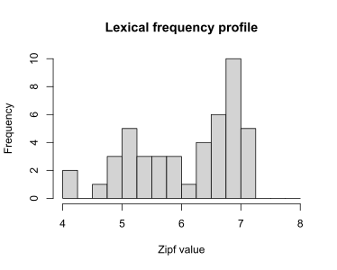
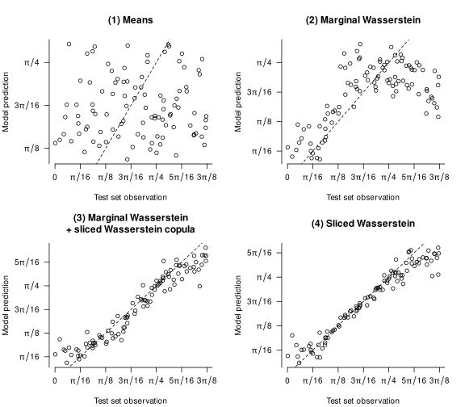
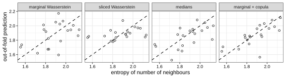

It's common for researchers to reduce the objects in which
they're interested to a handful of summary statistics 
before submitting them to a statistical model.
For instance, applied linguists interested in modelling text-quality ratings may want to
take into account the rarity of the words used in the texts.
To do so, they may look up the corpus frequency of each word used in the text,
summarise the resulting distributions through their mean or median,
and use these summaries in a linear regression model.
But was any predictively useful information about the frequency distributions
lost by reducing them to summary statistics?
This blog post explains one way in which statistical models 
can be built that address this and similar questions 
by representing the input objects as full-fledged probability distributions.

::: {.callout-tip}
## tl;dr
Summarising distributions so that they can be used as predictors in statistical
models may discard predictive information.
It is possible to take into account full distributions (including multivariate ones)
as inputs in predictive models by computing well-behaved distances 
between these distributions.
If a model using these distances doesn't outperform the model based on summary
statistics on test data or in cross-validation, 
then the summary probably wasn't losing much predictively relevant information.
If it does, this may motivate a closer look at the input distributions to
uncover which relevant aspects of them were glossed over by the summary statistics.
:::

## Roadmap
The idea is to compare the fit of predictive models in which the inputs
are represented using summary statistics to ones in which the inputs
are represented as full-fledged probability distributions.
Before we can do so, we need to do some _mise en place_.

The first ingredient is that the most commonly used
statistical methods in the social sciences (e.g., linear regression models)
expect each input to be a row of numbers.
Probability distributions are more complicated than such inputs, however.
So instead, we're going to use models that rely only on 
the pairwise similarities between the inputs. 
The first concept that I'll discuss below, then, is **similarity-based statistics**.

Once we know how we can build statistical models based on pairwise similarities
between the inputs, we still need a way to express similarities between
probability distributions. To this end, we're going to first compute distances
between probability distributions, and then use these distances to express
similarities. The second concept, then, concerns **distances between distributions**.

The third core idea is that a fair number of data structures that social scientists
work with can be understood or represented as probability distributions.
I'll give some examples under the heading **representing inputs as distributions**.

With a basic appreciation of these three core concepts,
we can finally turn to a few examples.

## Concept 1: Similarity-based statistics
The most widely used tools for tackling classification and regression problems
in the social sciences expect inputs to be represented as rows in a data frame.
For instance, in linear regression, a participant's predictor data 
may be represented as three numbers representing their sex, age, and 
language aptitude test score (i.e., a vector in three-dimensional Euclidean space), 
and their outcome data would be another number representing their L2 test score.

But certain statistical tools, including **Gaussian process regression** 
and **support vector machines**, don't rely on such explicit representations 
of the predictor data. Instead, they rely on a notion of the pairwise 
similarities between different observations.
The intuition behind tools based on pairwise similarities is that the prediction
for a new observation is obtained from the outcomes of the known observations
that are most similar to it.
If you want to learn more about Gaussian process regression,
Görtler et al. (2019) provide a wonderful 
[interactive introduction](https://doi.org/10.23915/distill.00017).
For another concise introduction, see Wang (2024);
for a longer treatment, refer to Rasmussen and Williams (2006).

We can't define the pairwise similarities willy-nilly, however:
our notion of similarity needs to satisfy a number of technical conditions.[^2]
If a function that takes in any two observations $x_i$ and $x_j$ 
outputs a valid similarity score $k(x_i, x_j)$, we call it a **kernel**.

[^2]: First, for any two objects $x$ and $x'$, $x$ must be as similar to $x'$
as $x'$ is to $x$. 
Second, if you put the pairwise similarities between the objects $x_1, \dots, x_n$ in a matrix,
$K = (k(x_i, x_j))_{i,j = 1}^n$
the matrix must be positive semi-definite for any possible choice of $n$ input objects
and for any $n$.

There exists a whole host of different functions that may serve as kernels,
and different kernels correspond to different notions of similarity.
On his blog [_Local optima_](https://anhosu.com/post/kernels-r/),
Anders Nielsen gives an extensive overview of the kernels
that can be used in Gaussian process regression.
For the purposes of this blog post, though, only 
so-called **stationary kernels** are relevant.
These are kernels that depend only on the distance between the inputs
$x_i$ and $x_j$, and not on the inputs themselves:
the smaller the distance between the inputs, the greater the kernel value
between them, that is, the greater their similarity.
I elaborate on three types of stationary kernel in the collapsed
info box below, but the main thing to appreciate is that 
the choice of kernel determines which kind of relationships between the input
and the outcome the model accommodates.
If you play around with the Shiny applet below, you'll see this principle
in action.

::: {.callout-note collapse="true"}
## Three types of stationary kernel
::: {.panel-tabset}
## Squared exponential kernel
The **squared exponential kernel**, also called the **Gaussian kernel**
or the **radial basis function kernel**, is defined as

$$k(x_i, x_j) = s^2\exp\left(-\frac{d(x_i, x_j)^2}{2t^2}\right),$$

with a scaling factor $s^2 > 0$ and a length-scale $t > 0$ as hyperparameters.
The kernel earns one of its monikers from its resemblance to the density function
of the Gaussian (Normal) distribution; see @fig-se-kernel.

```{r}
#| fig-cap: "The squared exponential kernel with $s^2 = 1$ and $t = 1$."
#| fig-width: 6.5
#| fig-height: 5.6
#| out-width: "4in"
#| label: fig-se-kernel
curve(exp(-x^2/2), from = 0, to = 4, xlab = "Distance",
      ylab = "Kernel value", lwd = 2,
      main = "Squared exponential kernel",
      bty = "n", las = 1)
```

It assigns large covariances to inputs that lie close
to each other but near-zero covariances to inputs that are more distant.
As a result, a model using this kernel can accommodate nonlinear relationships.
Since the drop-off in the function graph above starts out fairly mildly,
these expected nonlinear relationships are smooth.

This is visible in the plots in @fig-se-kernel-prior.
The plot on the left visualises the kernel/covariance matrix:
neighbouring values have high covariances,
distant values have low covariances.
The plot on the right illustrates the type of association between
the predictor and the outcome that a Gaussian process regression model
with this kind of covariance matrix anticipates.

```{r}
#| fig-cap: "Covariance matrix (left) and a few possible anticipated relationships (right) when using a squared exponential kernel with $s^2 = 1$ and $t = 1$. This kernel makes the model accommodate smooth relationships."
#| fig-height: 3.5
#| fig-width: 7
#| label: fig-se-kernel-prior
# Plotting function
plot_gpr <- function(x, K, n = 4, main = "") {
  cols <- RColorBrewer::brewer.pal(n, "Dark2")
  Y <- MASS::mvrnorm(n = n, mu = rep(0, length(x)), Sigma = K)
  plot(x = x, y = Y[1, ], ylim = range(Y), type = "n", las = 1,
     xlab = "x", ylab = "y", main = main, bty = "n")
  for (i in seq_len(n)) {
    points(x = x, y = Y[i, ], type = "l", col = cols[i])
  }
}

draw_all <- function(x, K, n = 4) {
  layout(matrix(c(0, 1, 2), nrow = 1), widths = c(0.1, 1, 2.2))
  corrplot::corrplot(K, is.corr = FALSE, method = "color", tl.pos = "n")
  x <- seq(-5, 5, length.out = ncol(K))

  wanted <- c(-4, -2, 0, 2, 4)
  pos <- sapply(wanted, function(v) which.min(abs(x - v)))
  n <- ncol(K)
  text(x = pos, y = n + 4.5, labels = wanted, xpd = NA)
  text(x = -2.5, y = n - pos + 1, labels = wanted, xpd = NA)

  mtext("Covariance matrix", line = -1, font = 2)

  plot_gpr(x, K, main = "Four draws from prior distribution")
}

# Predictor data and distances between them
x <- seq(-5, 5, by = 0.1)
D <- outer(x, x, "-") |> abs()

# SE kernel
K_rbf <- exp(-D^2 / 2)
draw_all(x, K_rbf)
```

## Power exponential kernel
The **power exponential kernel** is a generalisation of the squared exponential
kernel:
$$k(x_i, x_j) = 
s^2\exp\left(-\left(\frac{d(x_i, x_j)}{t}\right)^{\kappa}\right)$$
with an additional hyperparameter $\kappa \in (0, 2]$. 
For $\kappa = 2$, we obtain a squared exponential kernel with length-scale $t/\sqrt{2}$.

The graph below shows how the kernel values depend on $\kappa$. 
Note that for lower values of $\kappa$, more
distant observations (beyond the length-scale $t$) tend to have larger covariances 
than for higher values of $\kappa$.

```{r}
#| fig-cap: "The power exponential kernels for $\\kappa = 1/2, 1, 3/2$ with $s^2 = 1$ and $t = 1$."
#| fig-width: 6.5
#| fig-height: 5.6
#| out-width: "4in"
#| label: fig-pe-kernel
cols <- RColorBrewer::brewer.pal(3, "Dark2")
curve(exp(-abs(x)^(1/2)), from = 0, to = 4, xlab = "Distance",
      ylab = "Kernel value", lwd = 2,
      col = cols[1],
      main = "Power exponential kernels",
      bty = "n", las = 1, ylim = c(0, 1))
curve(exp(-abs(x)^(1)), add = TRUE, col = cols[2], lwd = 2)
curve(exp(-abs(x)^(3/2)), add = TRUE, col = cols[3], lwd = 2)
legend("topright", col = cols,
  legend = c(
    bquote(kappa == 1/2),
    bquote(kappa == 1),
    bquote(kappa == 3/2)
  ), lty = 1, lwd = 2
)
```

This is reflected in kinds of relationship that the model anticipates,
as shown in @fig-pe-kernel-prior-32, @fig-pe-kernel-prior-1, 
and @fig-pe-kernel-prior-12.

```{r}
#| fig-cap: "Covariance matrix (left) and a few possible anticipated relationships (right) when using a power exponential kernel with $\\kappa = 3/2$, $s^2 = 1$ and $t = 1$."
#| fig-height: 3.5
#| fig-width: 7
#| label: fig-pe-kernel-prior-32
K_pe32 <- exp(-D^(3/2))
draw_all(x, K_pe32)
```

```{r}
#| fig-cap: "Covariance matrix (left) and a few possible anticipated relationships (right) when using a power exponential kernel with $\\kappa = 1$, $s^2 = 1$ and $t = 1$."
#| fig-height: 3.5
#| fig-width: 7
#| label: fig-pe-kernel-prior-1
K_pe1 <- exp(-D)
draw_all(x, K_pe1)
```

```{r}
#| fig-cap: "Covariance matrix (left) and a few possible anticipated relationships (right) when using a power exponential kernel with $\\kappa = 1/2$, $s^2 = 1$ and $t = 1$."
#| fig-height: 3.5
#| fig-width: 7
#| label: fig-pe-kernel-prior-12
K_pe12 <- exp(-sqrt(D))
draw_all(x, K_pe12)
```

The $\kappa$ parameter, then, allows you to fiddle with the
degree of smoothness of the expected relationships.

## Matérn kernel
An alternative way to fiddle with the degree of smoothness
of the expected relationships is to turn to the **Matérn covariance functions**.
The definition of this family of kernels is fairly complicated,
but the important thing is that they have a smoothness parameter $\nu$.
Lower values of $\nu$ correspond to more jagged anticipated relationships;
higher values to smoother anticipated relationships.
The values $\nu = 1/2, 3/2, 5/2$ are popular because, for these values, 
the function can be expressed fairly easily.

```{r}
#| fig-cap: "The Matérn kernels for $\\nu = 1/2, 3/2, 5/2$."
#| fig-width: 6.5
#| fig-height: 5.6
#| out-width: "4in"
#| label: fig-matern-kernel
matern <- function(d, nu, rho = 1) {
  val <- 2^(1 - nu) / gamma(nu) * (sqrt(2 * nu) * d / rho)^nu * besselK(sqrt(2*nu)*d/rho, nu)
  if (is.matrix(val)) diag(val) <- 1
  val[d == 0] <- 1
  val
}
curve(matern(x, nu = 1/2), from = 0, to = 4, xlab = "Distance",
      ylab = "Kernel value", lwd = 2,
      main = "Matérn kernels",
      col = cols[1],
      ylim = c(0, 1),
      bty = "n", las = 1)
curve(matern(x, nu = 3/2), col = cols[2], lwd = 2, add = TRUE)
curve(matern(x, nu = 5/2), col = cols[3], lwd = 2, add = TRUE)
legend("topright", col = cols,
  legend = c(
    bquote(nu == 1/2),
    bquote(nu == 3/2),
    bquote(nu == 5/2)
  ), lty = 1, lwd = 2
)
```

We can see the effect of the smoothness parameter in 
@fig-matern-kernel-prior-52, @fig-matern-kernel-prior-32,
and @fig-matern-kernel-prior-12.
Incidentally, the Matérn kernel with $\nu = 1/2$ is identical 
to the power exponential kernel with $\kappa = 1$.

```{r}
#| fig-cap: "Covariance matrix (left) and a few possible anticipated relationships (right) when using a Matérn kernel with $\\nu = 5/2$."
#| fig-height: 3.5
#| fig-width: 7
#| label: fig-matern-kernel-prior-52
K_matern52 <- matern(D, 5/2)
draw_all(x, K_matern52)
```

```{r}
#| fig-cap: "Covariance matrix (left) and a few possible anticipated relationships (right) when using a Matérn kernel with $\\nu = 3/2$."
#| fig-height: 3.5
#| fig-width: 7
#| label: fig-matern-kernel-prior-32
K_matern32 <- matern(D, 3/2)
draw_all(x, K_matern32) 
```

```{r}
#| fig-cap: "Covariance matrix (left) and a few possible anticipated relationships (right) when using a Matérn kernel with $\\nu = 1/2$."
#| fig-height: 3.5
#| fig-width: 7
#| label: fig-matern-kernel-prior-12
K_matern12 <- matern(D, 1/2)
draw_all(x, K_matern12) 
```

:::
:::

Below is a Shiny applet that you can use to generate some data
and fit Gaussian process regression models to it.
You can play around with the scaling factor $s^2$,
the length-scale $t$ and a third hyperparameter $\eta^2$.
This last hyperparameter regulates how much the observed data may 
deviate from the fitted line.
You can also tune these hyperparameters automatically by clicking 
`Optimise hyperparameters`.
If you want to know how the automatic hyperparameter tuning works,
see chapter 5 of Rasmussen and Williams' (2006) book.

```{shinylive-r}
#| standalone: true
#| viewerHeight: 1800

library(shiny)
library(bslib)
library(corrplot)

# Stationary kernel functions --------------------------------------------------
rbf <- function(D, length_scale = 1, scaling_factor = 1) {
  scaling_factor * exp(-D^2 / (2 * length_scale^2))
}

powerexp12 <- function(D, length_scale = 1, scaling_factor = 1) {
  scaling_factor * exp(-(D / length_scale)^(1/2))
}

powerexp32 <- function(D, length_scale = 1, scaling_factor = 1) {
  scaling_factor * exp(-(D / length_scale)^(3/2))
}

matern12 <- function(D, length_scale = 1, scaling_factor = 1) {
  scaling_factor * exp(-D / length_scale)
}
matern32 <- function(D, length_scale = 1, scaling_factor = 1) {
  r <- sqrt(3) * D / length_scale
  scaling_factor * (1 + r) * exp(-r)
}
matern52 <- function(D, length_scale = 1, scaling_factor = 1) {
  r <- sqrt(5) * D / length_scale
  scaling_factor * (1 + r + r^2 / 3) * exp(-r)
}

kernel_list <- list(
  "Squared exponential" = rbf,
  "Power exponential (κ = 1/2)" = powerexp12,
  "Power exponential (κ = 3/2)" = powerexp32,
  "Matérn (ν = 1/2)"          = matern12,
  "Matérn (ν = 3/2)"          = matern32,
  "Matérn (ν = 5/2)"          = matern52
)

# GP conditional distribution --------------------------------------------------
cond_dist <- function(x, x0, y0, noise_var = 1e-6, kernel, ...) {
  mean_y <- mean(y0)
  y0 <- y0 - mean_y
  n  <- length(x)
  n0 <- length(x0)
  D  <- outer(c(x, x0), c(x, x0), "-") |> abs()
  K  <- kernel(D, ...)
  K11 <- K[seq_len(n), seq_len(n)]
  K12 <- K[seq_len(n), (n + 1):(n + n0)]
  K22 <- K[(n + 1):(n + n0), (n + 1):(n + n0)] + noise_var * diag(n0)
  L   <- tryCatch(chol(K22), error = function(e) NULL)
  if (is.null(L)) return(NULL)
  alpha <- backsolve(L, forwardsolve(t(L), y0))
  mu    <- as.vector(K12 %*% alpha)
  v     <- forwardsolve(t(L), t(K12))
  Sigma <- K11 - t(v) %*% v
  list(y = mu + mean_y, se = pmax(sqrt(diag(Sigma)), 0))
}

# Hyperparameter optimisation --------------------------------------------------
# Just BFGS without gradients for now.
find_gpr_hyperparameters <- function(x0, y0, kernel, runs = 10) {
  n <- length(y0)
  # Centre y at 0
  y_train <- y0 - mean(y0)
  D <- outer(x0, x0, "-") |> abs()
  # Obtain median distance between elements as useful length-scale init
  med_d <- median(D[upper.tri(D)])

  nll <- function(log_params) {
    va      <- exp(log_params[1])
    ls      <- exp(log_params[2])
    lambda2 <- exp(log_params[3])
    K <- kernel(D, length_scale = ls, scaling_factor = va) + lambda2 * diag(n)
    U <- tryCatch(chol(K), error = function(e) NULL)
    if (is.null(U)) return(Inf)
    a <- backsolve(U, backsolve(U, y_train, transpose = TRUE))
    drop(0.5 * crossprod(y_train, a) + sum(log(diag(U))) + n / 2 * log(2 * pi))
  }

  best <- NULL
  for (i in seq_len(runs)) {
    init <- c(
      scaling_factor     = runif(1, log(0.1), log(10)),
      length_scale = runif(1, log(med_d * 0.1), log(med_d * 10)),
      lambda2      = runif(1, -10, -2)
    )
    fit <- tryCatch(
      optim(init, nll, method = "BFGS"),
      error = function(e) NULL
    )
    if (!is.null(fit) && (is.null(best) || fit$value < best$value)) {
      best <- fit
    }
  }

  if (is.null(best)) return(NULL)
  list(
    scaling_factor = exp(best$par[1]),
    length_scale   = exp(best$par[2]),
    lambda2        = exp(best$par[3]),
    nll            = best$value
  )
}

# Preset functions -------------------------------------------------------------
preset_fns <- list(
  "smooth function"  = "x/7 + 0.01*x^2 + sin(cos(x)) + log(x^2 + 10)",
  "jagged function"  = "-0.05*x^2 + sin(1.5*x) + sign(sin(x))*1.5*abs(x %% 1 - 1/2)",
  "Custom…"             = NULL
)

# UI ---------------------------------------------------------------------------
ui <- page_sidebar(
  title = "Gaussian process regression with a stationary kernel",
  theme = bs_theme(bootswatch = "yeti"),

  sidebar = sidebar(
    width = 300,

    accordion(
      open = FALSE,
      accordion_panel(
        "Data-generating mechanism",
        selectInput("preset_fn", "True function:",
                    choices = names(preset_fns), 
                    selected = names(preset_fns)[1]),
        conditionalPanel(
          "input.preset_fn === 'Custom…'",
          textInput("custom_fn", "f(x) =", value = "sin(x)",
                    placeholder = "e.g., sin(x) + 0.5*x")
        ),
        sliderInput("x_range", "x range:",
                    min = -10, max = 10, value = c(-10, 10), step = 0.5),
        numericInput("noise", "Observation noise σ²:",
                     value = 0.5, min = 0, step = 0.1)
      )
    ),

    accordion(
      open = FALSE,
      accordion_panel(
        "Observations",
        radioButtons("x0_mode", "Specify points:",
                     choices = c("Random" = "random", "Manual" = "manual"),
                     inline = TRUE,
                     selected = "random"),
        conditionalPanel(
          "input.x0_mode === 'random'",
          sliderInput("n_pts", "Number of points:", 1, 100, 50, 
                      step = 1, ticks = FALSE),
          actionButton("resample", "Resample", class = "btn-primary w-100",
                       icon  = icon("dice"))
        ),
        conditionalPanel(
          "input.x0_mode === 'manual'",
          textInput("manual_x0", "x positions (comma-separated):", 
            value = "-9, -8, -7, -6, -5, -4, -3, -2, -1, 0, 1, 2, 3, 4, 5, 6, 7, 8, 9")
        )
      )
    ),

    accordion(
      open = FALSE,
      accordion_panel(
        "Kernel",
        selectInput("kernel", "Kernel function", choices = names(kernel_list)),
        uiOutput("hp_inputs"),
        hr(),
        tags$p("Optimise hyperparameters by maximising the 
               log marginal likelihood."),
        sliderInput("opt_runs", "Restarts:",
                    min = 10, max = 100, value = 50, step = 1, ticks = FALSE),
        actionButton("optimise", "Optimise hyperparameters",
                     class = "btn-primary w-100",
                     icon  = icon("wand-magic-sparkles")),
        uiOutput("opt_status")
      )
    )
  ),

  layout_columns(
    col_widths = 12,
    card(
      card_header("GP posterior"),
      plotOutput("gp_plot", height = "420px")
    ),
    card(
      card_header("Kernel covariance  k(x, x₀)"),
      plotOutput("kernel_plot", height = "200px")
    ),
    card(
      card_header("Covariance matrix"),
      plotOutput("corr_plot")
    )
  ),
)

# Server -----------------------------------------------------------------------
server <- function(input, output, session) {

  opt_msg     <- reactiveVal(NULL)
  opt_trigger <- reactiveVal(0)
  opt_params  <- reactiveVal(list(length_scale = 1, scaling_factor = 5, 
                                  log_noise_var = -0.3))

  # Show hyperparameter inputs
  output$hp_inputs <- renderUI({
    p <- opt_params()
    tagList(
      numericInput("length_scale", "Length scale t",
                   value = round(p$length_scale, 4), min = 0.01, step = 0.1),
      numericInput("scaling_factor", "Scaling factor s²",
                   value = round(p$scaling_factor, 4), min = 0.01, step = 0.1),
      numericInput("log_noise_var", "Noise variance η² (log-10 scale)",
                   value = round(p$log_noise_var, 2), step = 0.5)
    )
  })

  # Parse target function
  f <- reactive({
    expr_str <- if (input$preset_fn == "Custom…") input$custom_fn
                else preset_fns[[input$preset_fn]]
    tryCatch(
      eval(parse(text = paste0("function(x) ", expr_str))),
      error = function(e) NULL
    )
  })

  # Observation x locations
  x0_vals <- reactive({
    input$resample
    if (input$x0_mode == "random") {
      set.seed(input$resample)
      sort(runif(input$n_pts, input$x_range[1], input$x_range[2]))
    } else {
      vals <- suppressWarnings(
        as.numeric(trimws(strsplit(input$manual_x0, ",")[[1]])))
      sort(vals[!is.na(vals)])
    }
  })

  # Observations
  obs <- reactive({
    fn <- f()
    if (is.null(fn)) return(NULL)
    x0 <- x0_vals()
    y0 <- fn(x0) + rnorm(length(x0), sd = sqrt(input$noise))
    list(x0 = x0, y0 = y0)
  })

  # Prediction grid
  x_grid <- reactive({
    seq(input$x_range[1], input$x_range[2], length.out = 201)
  })

  # Step 1: show spinner and fire trigger
  observeEvent(input$optimise, {
    xy0 <- obs()
    if (is.null(xy0) || length(xy0$x0) < 3) {
      opt_msg(tags$span("⚠ Need at least 3 observations to optimise."))
      return()
    }
    opt_trigger(isolate(opt_trigger()) + 1)
  })

  # Step 2: run optimisation
  observeEvent(opt_trigger(), {
    req(opt_trigger() > 0)
    xy0  <- isolate(obs())
    kern <- kernel_list[[isolate(input$kernel)]]

    result <- tryCatch(
      find_gpr_hyperparameters(xy0$x0, xy0$y0, kernel = kern,
                               runs = isolate(input$opt_runs)),
      error = function(e) NULL
    )

    if (is.null(result)) {
      opt_msg(tags$span("✗ Optimisation failed. Try different settings."))
      return()
    }

    opt_params(list(
      length_scale = result$length_scale,
      scaling_factor = result$scaling_factor,
      log_noise_var = max(log10(result$lambda2), -30)
    ))

    opt_msg(tags$span(
      style = "color:#27ae60; font-size:0.82rem;",
      sprintf("✓ Done.  t = %.2f,  s² = %.2f,  η² = 10^%.1f  (NLL = %.1f)",
              result$length_scale, result$scaling_factor,
              log10(result$lambda2), result$nll)
    ))
  }, ignoreInit = TRUE)

  output$opt_status <- renderUI({ opt_msg() })

  # Active hyperparameters: opt_params when set, else input values
  hp <- reactive({
    p  <- opt_params()
    ls <- if (!is.null(input$length_scale)) input$length_scale 
                                       else p$length_scale
    sf <- if (!is.null(input$scaling_factor)) input$scaling_factor 
                                         else p$scaling_factor
    nv <- if (!is.null(input$log_noise_var)) input$log_noise_var  
                                        else p$log_noise_var
    list(length_scale = ls, scaling_factor = sf, log_noise_var = nv)
  })

  # GP fit
  gp_fit <- reactive({
    fn  <- f()
    if (is.null(fn)) return(NULL)
    xy0  <- obs()
    kern <- kernel_list[[input$kernel]]
    p    <- hp()
    req(p$length_scale, p$scaling_factor, p$log_noise_var)
    fit  <- cond_dist(x_grid(), xy0$x0, xy0$y0,
                      noise_var = 10^p$log_noise_var,
                      kernel = kern,
                      length_scale = p$length_scale,
                      scaling_factor = p$scaling_factor)
    list(fit = fit, x0 = xy0$x0, y0 = xy0$y0)
  })

  # GP posterior plot
  output$gp_plot <- renderPlot({
    fn  <- f()
    obj <- gp_fit()
    fit <- obj$fit
    x0  <- obj$x0
    y0  <- obj$y0
    x   <- x_grid()

    par(mar = c(4, 4, 1, 1), bg = "white", family = "sans")
    y_fn <- if (!is.null(fn)) fn(x) else rep(0, length(x))

    ylim_base <- if (!is.null(fit)) {
      range(c(fit$y + 2.5 * fit$se, fit$y - 2.5 * fit$se, y_fn), na.rm = TRUE)
    } else {
      range(y_fn, na.rm = TRUE)
    }
    ylim <- ylim_base + diff(ylim_base) * c(-0.05, 0.05)

    plot(NULL, xlim = input$x_range, ylim = ylim,
         xlab = "x", ylab = "y", bty = "l", las = 1)
    grid(col = "grey90", lty = 1)

    if (!is.null(fit)) {
      ord <- order(x)
      px  <- x[ord]
      pmu <- fit$y[ord]
      pse <- fit$se[ord]
      
      valid <- is.finite(pmu) & is.finite(pse)
      px  <- px[valid]
      pmu <- pmu[valid]
      pse <- pse[valid]
      
      poly_x <- c(px, rev(px))
      poly_y <- c(pmu + 2 * pse, rev(pmu - 2 * pse))
      polygon(poly_x, poly_y, col = adjustcolor("#2c7bb6", 0.15), border = NA)
      lines(px, pmu, col = "#2c7bb6", lwd = 2.5, lty = 1)
    }
    if (!is.null(fn)) {
      lines(x, y_fn, col = "#d7191c", lwd = 1.5, lty = 2)
    }
    points(x0, y0, pch = 21, bg = "white", col = "#333", cex = 1.6, lwd = 2)
    legend("topright", bty = "n", cex = 0.85,
           legend = c("Posterior mean", "±2 SE", "True function", "Observations"),
           lty    = c(1, NA, 2, NA),
           pch    = c(NA, 15, NA, 21),
           lwd    = c(2.5, NA, 1.5, NA),
           col    = c("#2c7bb6", adjustcolor("#2c7bb6", 0.3), "darkred", "#333"),
           pt.cex = c(NA, 2, NA, 1.6))
  })

  # Kernel covariance plot -----------------------------------------------------
  output$kernel_plot <- renderPlot({
    kern  <- kernel_list[[input$kernel]]
    p     <- hp()
    req(p$length_scale, p$scaling_factor)
    d_seq <- seq(0, max(abs(input$x_range)), length.out = 300)
    k_val <- kern(d_seq,
                  length_scale = p$length_scale,
                  scaling_factor     = p$scaling_factor)

    par(mar = c(4, 4, 0.5, 1), bg = "white", family = "sans")
    plot(d_seq, k_val, type = "l", col = "#2c7bb6", lwd = 2,
         xlab = "|x - x₀|", ylab = "k(x, x₀)", bty = "l", las = 1,
         ylim = c(0, p$scaling_factor * 1.05))
    grid(col = "grey90", lty = 1)
    abline(h = p$scaling_factor, lty = 3, col = "grey60")
  })
  
  # Implied covariance matrix -------------------------------------------------
  output$corr_plot <- renderPlot({
    x0 <- obs()$x0 |> sort()
    kern <- kernel_list[[input$kernel]]
    p <- hp()
    req(p$length_scale, p$scaling_factor, p$log_noise_var)
    D <- outer(x0, x0, "-") |> abs()
    M <- kern(D, 
              length_scale = p$length_scale, scaling_factor = p$scaling_factor)
    corrplot(M,
         method = "color",
         is.corr = FALSE,
         tl.col = "black",   
         tl.cex = 0.8)
  }, height = 380, width = 380)
}

shinyApp(ui, server)
```

## Concept 2: Distances between distributions
### Univariate distributions: Wasserstein distances
The goal is to apply kernel methods to input that are represented as distributions.
To this end, we need a suitable distance metric between probability distributions.
When dealing with _univariate_ distributions, it turns out that the 
**Wasserstein distance** between probability distributions can be useful.
Informally, the Wasserstein distance between probability distributions $P$
and $Q$ expresses what the least amount of effort is that you need to expend
in order to shift about the probability mass of distribution $P$ so that
it corresponds to distribution $Q$.

::: {.callout-note collapse="true"}
## Wasserstein distances: A simple example
Consider two finite distributions.

* Distribution $P$ assigns probability 2/8, 3/8, 1/8, and 2/8 to values
  -2, 1, 4, and 7, respectively.
* Distribution $Q$ assigns probability 3/8, 1/8, and 4/8 to values
  -1, 2, and 6, respectively.
  
The most efficient way of turning distribution $P$ into distribution $Q$
is this:

1. Take 2/8 probability from -2 and assign it to -1. 
   Cost: $2/8 \cdot |-2 - (-1)| = 2/8$.
2. Take 1/8 probability from 1 and assign it to -1.
   Cost: $1/8 \cdot |1-(-1)| = 2/8$.
3. Take 1/8 probability from 1 and assign it to 2.
   Cost: $1/8 \cdot |1-2| = 1/8$.
4. Take the remaining 1/8 probability from 1 and assign it to 6.
   Cost: $1/8 \cdot |1-6| = 5/8$.
5. Take the 1/8 probability from 4 and assign it to 6.
   Cost: $1/8 \cdot |4-6| = 2/8$.
6. Take the 2/8 probability from 7 and assign it to 6.
   Cost: $2/8 \cdot |7-6| = 2/8$.

The total cost of this operation is $14/8 = 1.75$.
The Wasserstein distance (of order $p = 1$) is hence 1.75.
See @fig-optimal-transport.

```{r}
#| fig-cap: "The most efficient way of turning distribution $P$ into distribution $Q$. The total cost is 1.75."
#| fig-width: 6.5
#| fig-height: 5.6
#| label: fig-optimal-transport
#| echo: false
# Supports xP, xQ, and probability masses wP, wQ
xP <- c(-2, 1, 4, 7)
wP <- c(2/8, 3/8, 1/8, 2/8)
xQ <- c(-1, 2, 6)
wQ <- c(3/8, 1/8, 4/8)

# Optimal plan (using absolute value)
cP <- cumsum(wP)
cQ <- cumsum(wQ)
breaks <- sort(unique(round(c(0, cP, cQ), 10)))
mass <- diff(breaks)
mid <- breaks[-1] - mass / 2
i <- sapply(mid, function(m) which(m < cP)[1])
j <- sapply(mid, function(m) which(m < cQ)[1])
plan <- data.frame(from = xP[i], to = xQ[j], mass = mass)
plan$cost <- plan$mass * abs(plan$from - plan$to)
W1 <- sum(plan$mass * abs(plan$from - plan$to))

# Figure
cols <- RColorBrewer::brewer.pal(3, "Set1")[1:2]
h <- 0.5  # height scaling of the mass bars
par(mar = c(4, 1, 2, 1), bty = "n")
plot(NULL, xlim = range(c(xP, xQ)) + c(-1, 1), ylim = c(-0.7, 1.7),
     xlab = "value", ylab = "", yaxt = "n", xaxt = "n",
     main = bquote(W[1](P, Q) == .(W1)))
axis(1, at = seq(min(c(xP, xQ)), max(c(xP, xQ))))

# Transport plan: line width proportional to mass moved
segments(plan$from, 1, plan$to, 0,
         lwd = plan$mass * 20, lend = 1)
for (i in seq_len(nrow(plan))) {
  text((plan$from[i] + plan$to[i])/2 - 0.5, 0.5, plan$mass[i])
}

# Distribution P (top, bars pointing up) and Q (bottom, bars pointing down)
segments(xP, 1, xP, 1 + wP * h * 2, lwd = 10, col = cols[1], lend = 1)
segments(xQ, 0, xQ, -wQ * h * 2, lwd = 10, col = cols[2], lend = 1)
text(xP, 1 + wP * h * 2, labels = paste0(wP * 8, "/8"), pos = 3, cex = 0.8)
text(xQ, -wQ * h * 2, labels = paste0(wQ * 8, "/8"), pos = 1, cex = 0.8)

mtext("P", side = 2, at = 1.2, las = 1, line = -1, col = cols[1], font = 2)
mtext("Q", side = 2, at = -0.3, las = 1, line = -1, col = cols[2], font = 2)
```

:::

More generally and more formally, for any $p \in [1, \infty)$, we define the
Wasserstein distance of order $p$ between two probability distributions
with finite $p$-th moment as

$$\mathbf{W}_p(P, Q) := \min_{\substack{X \sim P,\\Y \sim Q}}\left(\mathbb{E}(|X - Y|^p)\right)^{1/p}.$$

That may look a bit complicated, but it's pretty easy to compute 
if $P$ and $Q$ are empirical distributions; see Algorithm 2.1 in my thesis 
(Vanhove 2026).
While the Wasserstein distance is a true distance for any $p \in [1, \infty)$,
only two values of $p$ are useful in our kernel approach:

* We can set $p = 1$ and slot in the square root of the $\mathbf{W}_1$ distance,
  i.e., $\sqrt{\mathbf{W}_1}$ into the three types of stationary kernel discussed
  above.
* Or we can set $p = 2$ and slot in the $\mathbf{W}_2$ distance into these
  stationary kernels.

The reason is that kernels need to satisfy certain technical requirements.
For the stationary kernels discussed above, these requirements are met
if the distances used are 'Hilbertian'.
The details don't need to concern us here.
What's important is that the $\mathbf{W}_2$ distance is Hilbertian,
and square-root transforming the $\mathbf{W}_1$ distance makes it Hilbertian.
Hence, both $\mathbf{W}_2$ and $\sqrt{\mathbf{W}_1}$ can be plugged into
the three kinds of stationary kernel discussed earlier.

Incidentally, the Wasserstein distance goes by a few different names,
including the earth mover's distance (if $p = 1$),
the Kantorovich--Rubinstein metric, 
and the Mallow distance.

### Multivariate distributions: Marginal Wasserstein distances
The Wasserstein distance can also be defined on spaces of _multivariate_
probability distributions.
But there are two snags:

1. Wasserstein distances between multivariate probability distributions
    are _considerably_ more expensive to compute than Wasserstein distances
    between univariate distributions.
2. There are no known values for $p$ for which the $\mathbf{W}_p$
    distance between multivariate distributions can be plugged into our
    stationary kernels. (There are no known Wasserstein distances
    between multivariate distributions that are Hilbertian.)

One workaround is to work with Wasserstein distances between 
**marginal distributions**; let's call these **marginal Wasserstein distances**.
For instance, if the distributions we're working with live in three dimensions,
we compute Wasserstein distances between the three corresponding dimensions.
Each of these are distances between univariate distributions, so we can use them as before:
we construct a kernel for each of the dimensions, and then combine them.

One drawback of relying on marginal distributions only is 
that two distributions may look completely different from one another 
yet have the same marginal distributions, as in @fig-two-dists.

```{r, echo = FALSE}
#| fig-cap: "These two bivariate distributions are quite different yet have the same marginals."
#| fig-height: 4
#| fig-width: 7.2
#| out-width: "6in"
#| label: fig-two-dists
par(mfrow = c(1, 2), las = 1, bty = "n")
n <- 20
x <- rnorm(n)
y <- rnorm(n)
plot(x, y, asp = 1)
rug(x, side = 1)
rug(y, side = 2)
plot(sort(x), sort(y), asp = 1, xlab = "x", ylab = "y")
rug(x, side = 1)
rug(y, side = 2)
par(mfrow = c(1, 1))
```

A kernel based on marginal distributions only couldn't tell distributions
with the same marginals but different joint distributions apart -- and it's 
possible that the relevant signal isn't contained in the marginals but
rather in how the different components are related to each other.

### Multivariate distributions: Sliced Wasserstein distances
Marginal Wasserstein distances are just Wasserstein distances
between one-dimensional projections of the distributions.
One option to capture some of the difference between the two
distributions shown in @fig-two-dists is to project the 
distributions onto the line of identity and compute
the Wasserstein distance between the resulting univariate
distributions; see @fig-projection.

```{r, echo = FALSE}
#| fig-cap: "Projecting both distributions onto the $x = y$ line results in two different univariate distributions."
#| fig-height: 4
#| fig-width: 7.2
#| out-width: "6in"
#| label: fig-projection
par(mfrow = c(1, 2), las = 1, bty = "n")
projections1 <- (x + y)/2
projections2 <- (sort(x) + sort(y))/2
plot(x, y, asp = 1, xlim = range(projections1, projections2, x, y))
abline(a = 0, b = 1, lty = 2)
d <- (x + y)/sqrt(2)
points(d * 1/sqrt(2), d*1/sqrt(2), pch = 21, bg = "grey")
segments(x0 = x, x1 = d * 1/sqrt(2),
         y0 = y, y1 = d * 1/sqrt(2),
         lty = 3)

plot(sort(x), sort(y), asp = 1, xlab = "x", ylab = "y",
     xlim = range(projections1, projections2, x, y))
abline(a = 0, b = 1, lty = 2)
d <- (sort(x) + sort(y))/sqrt(2)
points(d * 1/sqrt(2), d*1/sqrt(2), pch = 21, bg = "grey")
segments(x0 = sort(x), x1 = d * 1/sqrt(2),
         y0 = sort(y), y1 = d * 1/sqrt(2),
         lty = 3)
par(mfrow = c(1, 1))
```

The **sliced Wasserstein distance** generalises this approach:
Rather than considering just projections onto the coordinate axes
(as for marginal Wasserstein distances)
or onto the line of identity (as in the example above),
we consider _all_ possible projections on lines through the origin
and aggregate the Wasserstein distances between the resulting one-dimensional
distributions.
In practical terms, we pick a bunch of lines through the origin at random,
project the distributions on them, compute the Wasserstein distances
between them, and aggregate them.

Sliced Wasserstein distances are fairly cheap to compute.
Crucially, if they are based on $\mathbf{W}_2$
or $\sqrt{\mathbf{W}_1}$ distances between the univariate projections,
they are Hilbertian. This means that they can be slotted 
into the three stationary kernels.
Moreover, they take the entire distributions into account, 
not just their marginals.
Sliced Wasserstein distances based on  $\mathbf{W}_2$ 
and $\sqrt{\mathbf{W}_1}$ are denoted
as $\mathbf{SW}_2$ and $\sqrt{\mathbf{SW}_1}$, respectively.

There are, of course, some disadvantages to using sliced Wasserstein distances.

First, well, they take into account the _entire_ distributions...
This includes aspects that may not be relevant for the regression task,
which may downgrade performance.

Second, sliced Wasserstein distances are scale-sensitive in a more
annoying way than Wasserstein and marginal Wasserstein distances are.
To elaborate, let's say we're comparing distributions of body heights
measured in centimetres and find that the Wasserstein distance between
them is 6.7.
If we re-express the same body heights into millimetres, we'd find that the
Wasserstein distance between the distributions is ten times larger, i.e., 67.
Wasserstein distances, then, are scale-sensitive.
But crucially, in all of the three stationary kernels above, we can simply adjust
the length-scale so that the resulting kernel values are still the same.

This doesn't quite work for sliced Wasserstein distances.
If we have two-dimensional distributions in which one dimension represents
body heights and another body weights, re-expressing the body heights 
from centimetres to millimetres doesn't have a predictable effect
on the distances between the distributions.
As a result, we can't adjust the length-scale of the kernel to absorb 
changes in the scale of the data.
So when working with sliced Wasserstein distances,
it's probably a good idea to standardise the input distributions in some way
so that the results don't depend on the arbitrary scale on which the data
are expressed.

::: {.callout-tip}
## Computing sliced Wasserstein distances in R
I wrote the [`slicer`](https://janhove.github.io/slicer) package to carry out
sliced Wasserstein computations. 
:::

::: {.callout-note}
## Other possibilities
Wasserstein and sliced Wasserstein distances are not the only ways to
express differences and similarities between distributions;
they are merely the ones that I'm most familiar with because
I wrote a thesis on them.
For some other options, 
see Muandet et al. (2017), Szabó et al. (2016), and Székely and Rizzo (2013).
:::

## Concept 3: Representing inputs as distributions
Many important data types don't occur naturally as rows in a data frame.
Consider the following three examples:

:::: {.columns}

::: {.column width="23%"}
.](caffeine.svg)
:::

::: {.column width="4%"}
:::

::: {.column width="36%"}

:::

::: {.column width="4%"}
:::

::: {.column width="33%"}

:::
::::


In all of these cases, 
we can try to represent certain characteristics
of the objects (e.g., the mean Zipf value) 
in **feature vectors** which can then be 
input into linear regression, random forests, etc.
While this inevitably results in a loss of information, the hope is 
that the feature vector captures the relevant aspects.

One alternative is to either treat or encode the objects as **probability distributions**
in the hopes that this loses less relevant information than a representation
by means of a feature vector does.
For lexical frequency profiles and point clouds, this representation
as a probability distribution is immediate:
We treat the lexical frequency profile or 
the point cloud as an empirical distribution in one- or multidimensional space,
respectively.
More generally, any time the inputs $x_1, \dots, x_N$ are 
$n_i \times d$ matrices (with possibly varying row numbers $n_i$), 
we can treat them as empirical $d$-dimensional distributions based on 
samples of size $n_i$.

For graphs such as molecular structures or social networks, 
a bit more work is required before the machinery introduced
above can be brought to bear, but useful encodings of graphs as
probability distributions exist; 
see Carpintero Perez et al. (2024) for an example.

The third core concept, then, is that if the data don't naturally 
occur as rows in a data frame, it may be possible to represent them
more faithfully as probability distributions,
allowing the Wasserstein--kernel approach to be brought to bear on them.

## Examples
I'm not going to advocate for the whole-scale adoption
of kernels methods and Wasserstein and sliced Wasserstein distances
in our field.
But I think these techniques could on occasion be useful, 
for instance to gauge if a simpler approach in which the input distributions
are summarised through a handful of statistics leaves any money on the table.

To illustrate what I mean, I present three examples.

::: {.callout-warning}
## Not a tutorial!
This blog post is long and complicated enough as it is.
I'd rather not exacerbate this by including lots of R code that takes
a fair amount of time to run.
Instead, I'll give a high-level description of what I did.
I used similar examples for my thesis, though,
and the R code for those is available from [GitHub](https://github.com/janhove/mscthesis).
:::

### A toy example
Let's first put the concepts above to the test in a toy example
in which the predictive signal is hidden partly in the marginal distributions
but mostly in the joint distributions.


**Data.** @fig-toy_example shows the set-up:
Empirical distributions are generated from bivariate Gaussian mixtures 
with four isotropic components laid out symmetrically around the origin. 
These distributions differ from one another in that they are rotated counterclockwise 
by an angle $\omega \in [0, 3\pi/8]$.
The goal of the analysis is to retrieve the specific angles 
by which the distributions have been rotated.

{#fig-toy_example width=80%}

::: {.callout-note collapse = "true"}
## A specially constructed example
This example is constructed in such a way that the means of the distributions
carry no information about the rotation angle $\omega$.
Moreover, the marginal distributions carry _some_ but not all information:
the marginal distributions are the same for a rotation angle of $\pi/4 + \delta$
as for a rotation angle of $\pi/4 - \delta$.
As a result, a model relying on the marginal distributions only can't distinguish
between, say, $\omega = \pi/6 = \pi/4 - \pi/12$ and $\omega = \pi/3 = \pi/4 + \pi/12$.
Rotation angles in $[0, \pi/8)$, by contrast, don't have a 'mirror distribution' with identical marginals,
so models relying on marginal distributions should perform well on these.
The joint distributions, however, are in principle distinguishable for any
$\omega \in [0, 3\pi/8]$.

All this means that we expect a model based on means not to outperform
the baseline at all, whereas a model based on the marginal distributions will do so.
However, both models will be outperformed by models that also take into account
the joint distributions.
:::

I sampled rotation angles $\omega_i \sim \textrm{Uniform}([0, 3\pi/8])$
independently, $i = 1, \dots, 150$, and used these to generate
$N = 150$ empirical distributions $P_1, \dots, P_N$ 
based on $n = 100$ observations each.

**Analysis.** Fifty distributions served as the training set; the remaining
hundred as the test set.
I fitted four Gaussian process models using the training set.

1. A model using kernels based on the distributions' means in the first and second dimension.
2. A model using kernels based on the marginal Wasserstein distances (of order $p = 2$) between the distributions.
3. A model like in 2. but additionally using a sliced Wasserstein kernel (of order $p = 2$) after applying 
   the probability integral transform to the distributions' marginals.
   This transformation throws away the information about the marginal distributions 
   but retains information about the association between the two dimensions 
   (the so-called 'copula').
   By comparing this model's performance to that of the previous one, 
   we get an idea of whether there's any predictively useful information
   in the distributions that's not already captured by their marginals.
4. A model using a sliced Wasserstein kernel (of order $p = 2$) on the raw input distributions.
   Like the third model, this model takes into account the entire distributions.
   The difference is that the third model could in principle assign greater
   weight to the marginal distributions (i.e., projections along the cardinal axes)
   via the separate kernels it uses,
   whereas this model weighs all projection directions equally.

All kernels were radial basis function kernels with tuned hyperparameters.
For models based on several kernels, these were added together;
this amounts to modelling main effects of the different kernels.

::: {.callout-note collapse = "true"}
## Metrics of model performance
The fit of the predictions to the test data was assessed through
the root mean squared error (RMSE) and the negative log predictive density (NLPD). 
The RMSE purely assesses fit of the predictions to the test data and is defined as
$$\sqrt{\frac{1}{n}\sum_{i=1}^n(y_i - \hat y_i)^2},$$
where $y_1, \dots, y_n$ are the true outcomes in the test set
and $\hat y_1, \dots, \hat y_n$ are the corresponding predicted outcomes.

Gaussian process regression models don't just produce point predictions;
they generate an entire joint distribution for the predictions.
This distribution takes the form of a Normal distribution
with a mean vector $\hat{\boldsymbol \mu} = (\hat y_1, \dots, \hat y_n)^{\top}$
and a covariance matrix $\hat{\boldsymbol \Sigma} \in \mathbb{R}^{n \times n}$.
The NLPD is defined as
$$-\log p(y_1, \dots, y_n; \hat{\boldsymbol \mu}, \hat{\boldsymbol \Sigma}),$$
where $p(\cdot; \hat{\boldsymbol \mu}, \hat{\boldsymbol \Sigma})$ denotes
the density function of the $n$-variate Normal distribution with mean vector
$\hat{\boldsymbol \mu}$ and covariance matrix $\hat{\boldsymbol \Sigma}$.

In crossvalidation, I use the average NLPD instead of the formula above.
That is, I compute the NLPD for each (univariate) prediction
and then average these values.

Both metrics have in common that 'lower is better'.
:::

**Results.** The table below summarises the results of the different models.
A baseline model that just assigns the training set mean 
to the test set observations has a RMSE of $0.33$ radians.

| Model                | RMSE              | NLPD              |
|:---------------------|------------------:|------------------:|
| (1) Means            | 0.35              | 0.43              |
| (2) Marginal $\mathbf{W}_2$ | 0.26          | 0.20              |
| (3) Marginal $\mathbf{W}_2$ + $\mathbf{SW}_2$ copula | 0.10 | -1.11 |
| (4) $\mathbf{SW}_2$  | 0.10              | -1.40             |

@fig-toy_example_results shows the models fits graphically.

{#fig-toy_example_results .preview-image}

**Discussion.** The results match our expectations. Relying
on merely the means throws away _all_ predictive information in the inputs:
the first model doesn't perform better than the baseline.
Adding the marginal distributions improves performance considerably,
but as a comparison of models 2 and 3 reveals, a lot of information is
contained in the copula (i.e., in how both variables are associated).
The two models based on sliced Wasserstein distances that take into account
the whole distributions (rather than just the marginals) correspondingly
outperform the other models.

Of course, this example is extremely artificial.
But it does show that, in principle, this approach can help analysts 
to identify situations in which relying on summary statistics throws
away useful information.

Let's now turn to two more realistic examples.

### Lexical frequency profiles for text-quality predictions
**Context.** In Vanhove et al. (2019),
we had raters evaluate over 3,000 texts in terms 
of their lexical richness. 
We then tried to build models that predict 
these ratings by means of indices that can be computed
more or less automatically from the texts.
One of these was the mean of the distribution
of the frequencies of the lemmata encountered
in the text according to an external corpus 
("lexical frequency profiles").
Could we improve such models by taking the whole
frequency distributions into account rather than just
their means?

**Data.** The dataset comprises 3,060 short
narrative and argumentative texts in French,
German, and Portuguese (about 1,000 texts per language).
These texts were written by children living in
Switzerland and Portugal aged between about 8 and 10 years,
and the median text lengths were 37, 33, and 39 tokens,
respectively.
These texts were corrected morphosyntactically,
orthographically, and in terms of their punctuation
before rating and lexical analysis.

For each language, the texts were split up into 
twenty batches of 50 to 52 texts. Each batch
was rated by a separate panel of untrained adult
native speakers of the language in question.
These raters were asked to rate the lexical richness
of each of the 50--52 texts on a scale from
1 (worst) to 9 (best).
Each batch was rated by between three and eighteen raters,
with the average number of raters being
7.3 for French, 16.1 for German, and 5.3 for Portuguese.
The mean rating per text serves as the text-quality
rating to be predicted.

**Lexical metrics.** The lexical metrics used in this
reanalysis are the same as those used in one of the
models we fitted in Vanhove et al. (2019).
I refer to these metrics as the 'volume', 'variability',
'evenness', 'disparity', 'dispersion', and 'rarity' predictors.
As far as the first five of these predictors are concerned,
the details don't matter for our present purposes;
please refer to the original article if you're interested.

It is the sixth predictor, rarity, that is the focus of this reanalysis.
It consists of the mean Zipf score of the unique lemmata in the text.
The Zipf score is a transformation of corpus frequency 
that is thought to better capture language users' perception 
of the relative frequency of words (van Heuven et al. 2014).

**Reanalysis.**
For the original article, we split up the dataset into sixteen batches of texts
per language for training the models and four batches per language for testing
them. For the reanalysis, I'll do the same, using the same training and testing
split as in the original.

In the original article, we used generalised additive models.
For this reanalysis, I'll use Gaussian process regression even for
the models that don't include distributional inputs.
The reason is that I don't want the comparisons between the models
to be tainted by differences in the models' architectures.

For each of the six metrics, I constructed a squared-exponential kernel.
Additionally, I constructed squared-exponential kernels for two distributional inputs:
the Zipf frequency scores of the unique lemmata occurring in the texts,
and the mean-centred version of these Zipf scores.

For each language, I fitted four models:

1. A model using the kernels based on the volume, variability, evenness, disparity, and dispersion
   predictors to see how well a baseline model without frequency information would fare.[^1]
2. A model that additionally included a kernel based on the rarity predictor (i.e., mean frequency).
3. A model using the same kernels as in 1., 
   but adding a kernel based on the $\mathbf{W}_2$ distances between the lexical frequency profiles.
4. A model using the same kernels as in 2. (i.e., kernels for all 6 dimensions),
   but adding a kernel based on the $\mathbf{W}_2$ distances between the mean-centred lexical frequency profiles. The idea is to see if information about the _shape_ as opposed to the _location_ of the lexical frequency profiles has some predictive value.
   
[^1]: The different kernels were added together after their scaling factors and length-scales were tuned.


**Results.** The table below summarises the test set performance of the four models
for each of the three languages.

| Language | Zipf included?                | RMSE              | NLPD              |
|:---------|:------------------------------|------------------:|------------------:|
| French   | (1) no                        | 1.02              | 1.45              |
|          | (2) mean                      | 0.98              | 1.42              |
|          | (3) distribution              | 0.97              | 1.39              |
|          | (4) mean and centred distribution | 0.98          | 1.41              |
| German   | (1) no                        | 0.88              | 1.29              |
|          | (2) mean                      | 0.79              | 1.18              |
|          | (3) distribution              | 0.80              | 1.20              |
|          | (4) mean and centred distribution | 0.79          | 1.19              |
| Portuguese   | (1) no                    | 0.91              | 1.34              |
|          | (2) mean                      | 0.87              | 1.29              |
|          | (3) distribution              | 0.89              | 1.30              |
|          | (4) mean and centred distribution | 0.88          | 1.30              |

**Discussion.** For all three languages, adding a kernel based on the mean Zipf scores
improves model performance. Comparing models (4) to (2), however, shows that
that adding information about the shape of the distributions doesn't improve
the models any further.
Comparing models (3) to (2) confirms this: if the non-centred distributions
are fed to a kernel, the models perform similarly to when the distribution 
means are used, not better.

For these short texts, then, we don't find evidence that the mean
of the Zipf scores throws away predictively useful information about
the texts' lexical profiles.
It is, of course, quite possible that longer texts would have allowed us
to pick up on predictively useful differences between the shapes of the
distributions.
Another caveat is that I didn't go the whole hog and try out different
types of kernel, but I doubt that the results would look much different
if I'd used Matérn or power exponential kernels or kernels based on
$\sqrt{\mathbf{W}_1}$ distances instead.

### Hippocampi as distributions of neuron properties
The previous example featured lots of univariate distributions
based on fairly small samples;
the present one features a handful of multivariate distributions
based on large samples.

**Context and data.** 
Eckermann et al. (2021) studied the hippocampi of twenty diseased individuals.
Skipping over many details, each of these hippocampi was represented by
an $n_i \times 5$ matrix, with the number of rows $n_i$ varying from
2,748 to 37,348 (median: 17,069).
Each of these rows represented a neuron detected in the hippocampus in terms
of five measurements; again the details are not crucial for our purposes.
What is important, though, is that these five properties were measured
on entirely different scales.
@fig-eckermann shows what the data for one of the twenty hippocampi look like.

```{r}
#| fig-cap: "The marginal distributions of and pairwise associations between the neuron measurements in one of the twenty hippocampi in Eckermann et al.'s (2021) study. The bottom triangle shows Pearson correlation coefficients."
#| fig-height: 8
#| fig-width: 8
#| out-width: "6in"
#| label: fig-eckermann
#| echo: false
#| message: false
source("functions/scatterplot_matrix.R")
read.csv("brain4.csv") |> 
  scatterplot_matrix(
    labels = c("Neighbours", "Compactness", "Norm. variance", "Volume", "Sphericity"),
    main = "Distribution for brain 4"
  )
```

For the purposes of this reanalysis, the goal is to build a predictive model
of the entropy of the first variable (Neighbours) 
using the information contained in the other four variables.
This wasn't Eckermann et al.'s goal, but it illustrates how the techniques
discussed in this post can be put to use;
the entropy outcome is merely an arbitrary target.

**Analysis.** Since the number of input matrices is small ($N = 20$),
I used leave-one-out crossvalidation (LOOCV) to compare the predictive accuracy
of the different models. This means that the outcome value of each hippocampus
was predicted based on models that were trained only on the other nineteen
hippocampi.

I fitted a number of different models. 
Like in the previous examples, all kernels used were squared-exponential kernels.

1. A model using kernels based on the _medians_ of the distributions of the other four variables
   (four kernels in total).
   I used the medians because of the strong skew in some of the variables.
2. A model using kernels based on the $\mathbf{W}_2$ distances between the marginal distributions
   of each variable (four kernels in total).
3. A model using kernels based on the $\mathbf{W}_2$ distances between the marginal distributions
   of each variable as well as a kernel based on the sliced Wasserstein (of order $p = 2$)
   between the four distributions after applying the probability integral transform
   to its four marginals (five kernels in total).
4. A model using a kernel based on the sliced Wasserstein distances (of order $p = 2$)
   between the scaled four-dimensional distributions (one kernel in total).

Some further explanation:   

* By comparing model (2) to model (1), we can gauge if there is any predictively
  useful information in the marginal distributions that isn't captured by their medians.
* If model (3) performs better than models (2) and (1), this suggests that the 
  distributions contain predictively useful information that isn't even captured
  by their marginals. That is, there may be some useful information in how
  the variables within each distribution are related to each other (i.e., in the copula).
* Since sliced Wasserstein distances are scale-sensitive, 
  each input distribution is scaled as follows for the fourth model.
  When predicting the $i$-th outcome, I computed a pooled estimate of the
  joint covariance matrix of the other nineteen distributions as
  $$\widehat{\boldsymbol{\Sigma}}_i = \frac{1}{19}\sum_{j \neq i}\widehat{\boldsymbol{\Sigma}}(\boldsymbol{M}_j),$$
  where $\widehat{\boldsymbol{\Sigma}}(\boldsymbol{M}_j)$ is the usual
  sample estimate of the covariance matrix based on data matrix $\boldsymbol{M}_j$.
  The input matrices were then scaled as
  $$\widetilde{\boldsymbol{M}}_k = \boldsymbol{M}_k\boldsymbol{S}_i,$$
  where $\boldsymbol{S}_i$ is the diagonal matrix containing the multiplicative inverses
  of the square roots of the diagonal elements of $\widehat{\boldsymbol{\Sigma}}_i$,
  $k = 1, \dots, 20$.
  
**Results.** The following table summarises how well each model predicted
the out-of-fold data. For the NLPD, both the mean and the standard deviation
over the twenty outcomes are shown.
For reference, a baseline model that does not take into account any predictors
and just outputs the mean of the training set outcome scores an RMSE of 0.165.

| Model                                                   | RMSE | NLPD (mean $\pm$ SD) |
|---------------------------------------------------------|-----:|-----------------:|
| (1) Medians                                             | 0.13 | 12.42 $\pm$ 22.83  |
| (2) Marginal $\mathbf{W}_2$                             | 0.17 | 0.59 $\pm$ 2.10 |
| (3) Marginal  $\mathbf{W}_2$ + $\mathbf{SW}_2$ on copula| 0.11 | -0.70 $\pm$ 1.63 |
| (4) $\mathbf{SW}_2$ on scaled inputs                    | 0.15 | -0.36 $\pm$ 0.99 |

@fig-results-brains shows the fit of the predictions to the true values;
points close to the dashed line represent more accurate predictions.

{#fig-results-brains}

**Discussion.**
The medians-only model outperforms the models 
based on marginal Wasserstein distances and on sliced Wasserstein distances
in terms of the RMSE.
However, the large mean NLPD value for this model, coupled with a large standard deviation,
shows that for some out-of-fold predictions, the model's uncertainty estimates were badly overconfident.

Still, the comparison of model (1) on the one hand and models (2) through (4)
the other highlights that the Wasserstein--kernel approach isn't a silver bullet.
The median representations may be serviceable (in terms of their RMSE)
precisely because they do _not_ capture the full (joint or marginal) distributions;
the Wasserstein-based kernels capture these warts and all
(i.e., distributional aspects that simply aren't relevant to the task at hand).

Further, each input distribution in the present example is based on 
a substantial number of observations, but only few distributions were available
to train and evaluate the regression models on,
and the models may struggle to find adequate hyperparameter values
that allow them to outperform this simpler representation.

Finally, a model using both the marginal Wasserstein distances
and a kernel based on the sliced Wasserstein distances between the copulae
(i.e., the dependency structure between the variables)
seems to perform best of all. 
This could suggest that some of the relevant information
in the data isn't contained in the marginal distributions but rather in
the associations between the different variables.
But with $N = 20$, these speculations are tenuous at best.

## Conclusion
One way to check if summarising input distributions by a mean, median
or some other small number of statistics loses useful information 
is to compute the (sliced) Wasserstein distances between them
and then use these distances in a kernel-based
model such as Gaussian process regression.
If this model predicts new data no better than the summary-based model,
the summary probably wasn't losing a lot of useful information.
If it does better, it may be worth examining the distributions to figure out
what the summaries missed and how to capture it better.

The first example shows the promise of this approach.
The signal was hidden entirely in the shape of the distribution rather than in 
their location.
The sliced Wasserstein-based approach was able to demonstrate that the summary-based
model missed crucial information.
The other two more realistic examples, meanwhile, underscore the limits
of the approach: models that take into account richer representations of the inputs
don't have to outperform models based on leaner representations.
Of course, it's always possible that with more data (longer texts, more hippocampi),
a model incorporating sliced Wasserstein distances could find some additional
signal in the richer distributional representations.
But for the data at hand, this does not seem to have been the case.

In sum, the approach above doesn't turbo-charge predictive models derived
from distributional inputs. But it may serve as a diagnostic tool to check
if models based on summary statistics are leaving money on the table.

## References
Carpintero Perez, Raphaël, Sébastian Da Veiga,
Josselin Garnier and Brian Staber.
2024.
[Gaussian process regression with sliced Wasserstein Weisfeiler--Lehman graph kernels.](https://proceedings.mlr.press/v238/carpintero-perez24a.html)
_Proceedings of Machine Learning Research_ 238.
1297--1305.

Eckermann, Marina, Bernhard Schmitzer, Franziska van der Meer,
Jonas Franz, Ove Hansen, Christine Stadelmann and Timm Salditt.
2021.
[Three-dimensional virtual histology of the human hippocampus based on phase-contrast computed tomography.](https://doi.org/10.1073/pnas.2113835118)
_PNAS_ 118(48).
e2113835118.

Görtler, Joachim, Rebecca Kehlbeck and Oliver Deussen.
2019.
[A visual exploration of Gaussian processes.](https://doi.org/10.23915/distill.00017)
_Distill._

Kusner, Matt, Yu Sun, Nicholas Kolkin and Kilian Weinberger.
2015.
[From word embeddings to document distances.](https://proceedings.mlr.press/v37/kusnerb15)
_Proceedings of Machine Learning Research_ 37.
957--966.

Muandet, Krikamol, Kenji Fukumizu, Bharath Sriperumbudur and Bernhard Schölkopf.
2017.
[Kernel mean embedding of distributions: A review and beyond.](https://doi.org/10.1561/220000006)
_Foundations and Trends in Machine Learning_ 10(1-2).
1--141.

Rasmussen, Carl Edward and Christopher K. I. Williams.
2006.
[_Gaussian processes for machine learning._](https://gaussianprocess.org/gpml/)
MIT Press.

Szabó, Zoltán, Bharath K. Sriperumbudur, Barnabás Póczos and Arthur Gretton.
2016.
[Learning theory for distribution regression.](https://www.jmlr.org/papers/v17/14-510.html)
_Journal of Machine Learning Research_ 17(152).
1--40.

Székely, Gábor J. and Maria L. Rizzo.
2013.
[Energy statistics: A class of statistics based on distances.](https://doi.org/10.1016/j.jspi.2013.03.018)
_Journal of Statistical Planning and Inference_ 143(8).
1249--1272.

van Heuven, Walter J. B., Pawel Mandera,
Emmanuel Keuleers and Marc Brysbaert.
2014.
[SUBTLEX-UK: A new and improved frequency database for British English.](https://doi.org/10.1080/17470218.2013.850521)
_Quarterly Journal of Experimental Psychology_ 67(6).
1176--1190.

Vanhove, Jan.
2026.
[_Sliced Wasserstein distances and their application to regression problems._](https://janhove.github.io/SlicedWasserstein_Vanhove.pdf)
Master's thesis.
University of Bern.

Vanhove, Jan, Audrey Bonvin, Amelia Lambelet 
and Raphael Berthele.
2019.
[Predicting perceptions of the lexical richness of short French, German, and Portuguese texts using text-based indices.](https://doi.org/10.17239/jowr-2019.10.03.04)
_Journal of Writing Research_ 10(3).
499--525.

Wang, Jie. 
2024.
[An intuitive tutorial to Gaussian process regression.](https://arxiv.org/abs/2009.10862)
_arXiv_.